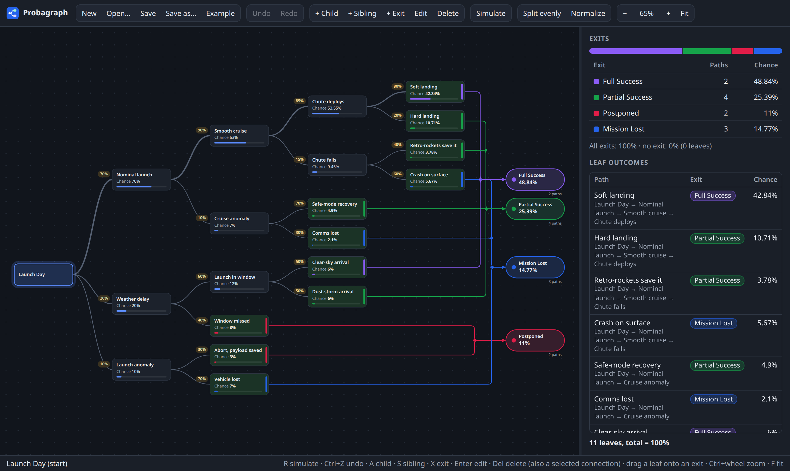
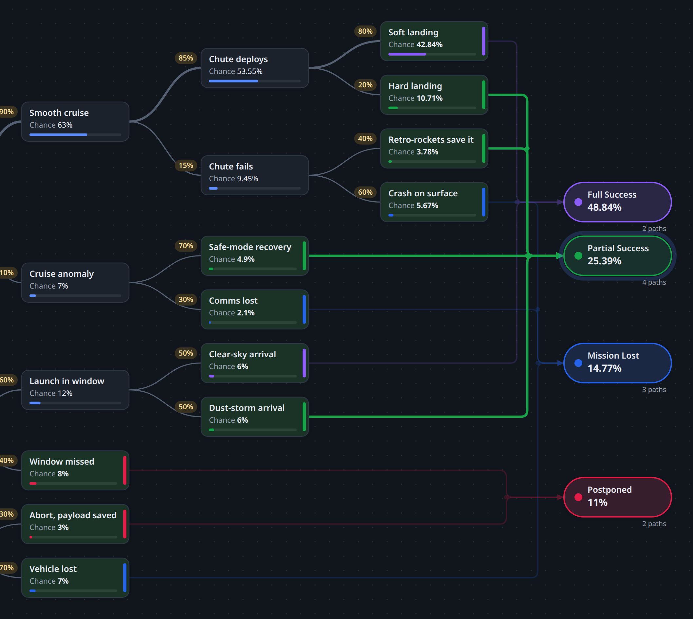
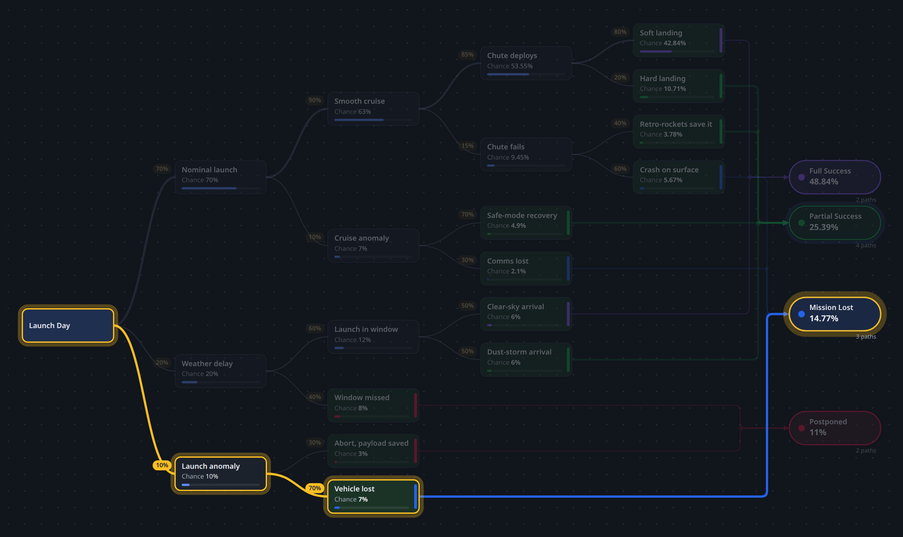

# Probagraph

Probagraph is a tool for building probability trees and seeing the chance of every
outcome. It runs in the browser and as a desktop app on Linux, macOS and Windows.

Web version: https://samherts.github.io/Probagraph/



## Installing

The web version needs no installing. For the desktop app, download the installer for
your system from the latest release:
https://github.com/SamHerts/Probagraph/releases/latest

The installers aren't signed with a paid developer certificate, so Windows and macOS
warn the first time you open them. The steps below get past that.

### Windows

Download `Probagraph_<version>_x64-setup.exe` and run it. If Windows shows "Windows
protected your PC", click "More info", then "Run anyway". The `.msi` file installs the
same app, for when an MSI package is needed. Windows 10 and 11 already include the
WebView2 runtime the app uses; on older systems the installer downloads it.

### macOS

Download `Probagraph_<version>_universal.dmg`, which runs on both Apple Silicon and
Intel Macs. Open it and drag Probagraph into Applications. The first time you open the
app, macOS says it can't verify the developer: click "Done", then open System Settings,
go to Privacy & Security, and click "Open Anyway" next to the message about
Probagraph. After that it opens normally.

### Linux

There are three packages; use whichever suits your distribution.

On Debian, Ubuntu and similar:

```
sudo apt install ./Probagraph_<version>_amd64.deb
```

On Fedora, RHEL and similar:

```
sudo dnf install ./Probagraph-<version>-1.x86_64.rpm
```

On any distribution, the AppImage runs without installing:

```
chmod +x Probagraph_<version>_amd64.AppImage
./Probagraph_<version>_amd64.AppImage
```

If the AppImage doesn't start, your system may be missing FUSE 2 (`sudo apt install
libfuse2` on Ubuntu).

## How it works

A tree starts from a single entrance node and grows left to right. Each branch has a
probability, and every node shows its chance of being reached: the product of the
branch probabilities along its path. The side panel lists every leaf outcome and
their total.

Exits are named outcomes, such as "Success" or "Mission lost", that several leaves
can lead into. Each exit shows the combined probability of every path that ends in
it. Only leaves can lead to an exit, so adding a branch to a linked leaf unlinks it.



Each node shows its chance below its name, and the yellow label on the line into it is
the branch probability. Selecting an exit highlights the connections that lead into it.

Simulate runs a single event: starting at the entrance node, it takes each branch at
random according to its probability, and highlights the path it took and the exit it
reached.



Probabilities can be entered as percentages (25 or 25%) or fractions (1/4). A new
branch defaults to whatever probability its siblings haven't used yet. Nodes whose
branches don't add up to 100% are outlined in orange. Probabilities are kept to 12
decimal places and shown to 4 (of a percent); a sum that shows as 100% counts as
complete.

## Controls

- Select a node: click it, or move with the arrow keys
- Add a child branch: A or Tab, the toolbar, the right-click menu, or double-click empty space
- Add a sibling branch: S
- Edit a label or probability: double-click the node, Enter, or F2
- Rename an exit or change its color: double-click the exit, Enter, or F2
- Add an exit: X (if a leaf is selected, it is linked to the new exit)
- Link a leaf to an exit: drag the leaf onto the exit, use "Send to exit" in the
  right-click menu, or pick or type one in the leaf's edit dialog
- Delete a node and its subtree, or an exit: Delete or Backspace
- Remove a single connection from a leaf to an exit: click the connection, then
  Delete or Backspace
- Split children evenly, or scale them to 100%: toolbar or right-click menu
- Pan: drag empty space, or scroll (Shift for horizontal)
- Zoom: Ctrl+scroll or pinch, Ctrl+plus and Ctrl+minus, Ctrl+0 to reset, F to fit
- Simulate one event: R or the Simulate button. The run starts at the entrance node
  and takes each branch at random according to its probability, highlighting the path
  it takes and the exit it reaches. Esc clears it.
- Undo and redo: Ctrl+Z, and Ctrl+Shift+Z or Ctrl+Y (also in the toolbar)
- Save and open: Ctrl+S and Ctrl+O

## Building from source

Probagraph is written in TypeScript and drawn with SVG. It needs Node.js 20 or newer.

```
npm install
npm run dev     # opens at http://localhost:5173
npm test
npm run build   # static site in dist
```

In the browser, Save writes straight back to the file in Chrome and Edge. Other
browsers download a copy instead. The open tree is also kept in the browser's local
storage, so refreshing or closing the tab brings it back next time, including unsaved
changes. That copy only lives in that browser, so save to a file to keep your work.

### Desktop app

The desktop app wraps the same code with Tauri. It needs Rust
(https://rustup.rs) and Tauri's system dependencies
(https://tauri.app/start/prerequisites/). On Fedora:

```
sudo dnf install webkit2gtk4.1-devel openssl-devel libappindicator-gtk3-devel librsvg2-devel libxdo-devel dbus-devel
sudo dnf group install c-development
```

Then:

```
npm run desktop         # run in a window, with live reload
npm run desktop:build   # installers in src-tauri/target/release/bundle
```

Installers can only be built for the system you build on, so the Linux, macOS and
Windows ones are built on GitHub instead.

### Building the installers on GitHub

The workflow in `.github/workflows/desktop.yml` builds the installers for all three
systems. To publish a release, set the new version and push it with its tag:

```
npm version 0.2.0
git push --follow-tags
```

`npm version` updates the version in `package.json` (which the app takes its version
from), commits it and tags it `v0.2.0`. When the tag arrives, the workflow builds the
installers and publishes them as a GitHub release, which the download link above
always points to. It stops if the tag doesn't match the version in `package.json`.

To build the installers without publishing anything, run the "Desktop builds" workflow
by hand from the Actions tab. The installers are then attached to that workflow run as
downloads.

### Publishing the web version

`.github/workflows/web.yml` tests and builds the web app on every push and pull
request, and deploys it to GitHub Pages on every push to `main`. To set it up once,
open the repository's Settings, go to Pages, and set Source to "GitHub Actions".

## File format

Trees are saved as JSON with one node per line. Each node points at its parent's id,
so the file stays flat however deep the tree grows:

```json
{
  "version": 3,
  "exits": ["Win"],
  "nodes": [
    {"id": 0, "label": "Start"},
    {"id": 1, "parent": 0, "label": "A", "prob": 0.25, "exit": "Win"},
    {"id": 2, "parent": 0, "label": "B", "prob": 0.75}
  ]
}
```

An exit with a chosen color is saved as `{"label": "Win", "color": "#16a34a"}` instead
of just its name. Files saved in the older nested format still open. `examples/mars_lander.json` is a
worked example.
